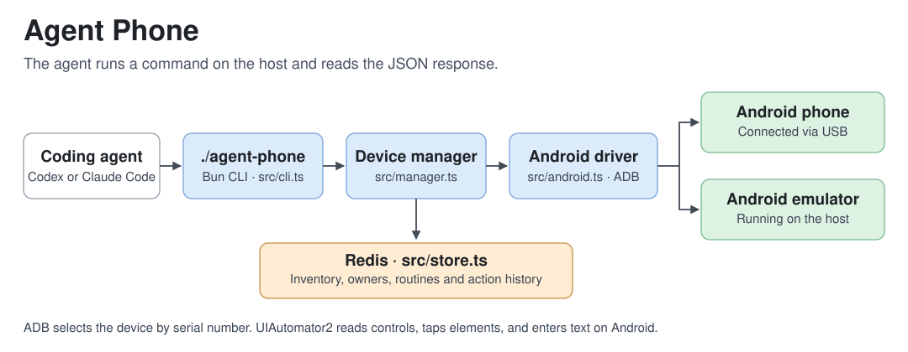

# Agent Phone

Agent Phone lets a coding agent control Android one step at a time. It uses UIAutomator2 to read text and controls on the screen. The agent can open an app, tap a button, fill in a field, and check what changed.



## Connect a device

Install Bun, `uv`, and Android SDK Platform-Tools on the Mac. Run the CLI from the project directory.

For a USB phone, turn on **USB debugging** and authorize the Mac on the phone. For an emulator, start it in Android Studio’s **Device Manager**.

## Open Settings and check the result

Run `./agent-phone devices` and replace `emulator-5554` with the serial number of your device.

```sh
SERIAL=emulator-5554
./agent-phone lease "$SERIAL" --why "Explore Android settings"
./agent-phone open "$SERIAL" com.android.settings --why "Open Settings"
./agent-phone state "$SERIAL" --why "Check which app is in the foreground"
./agent-phone snapshot "$SERIAL" --why "Read the controls on screen"
./agent-phone release "$SERIAL"
```

When Settings is in the foreground, `state` reports `com.android.settings` in `answer.app`. Use the labels and IDs from `snapshot` to choose what to tap next.

Run `./agent-phone --help` for the full command list. Codex and Claude Code use the [agent instructions](AGENTS.md).
